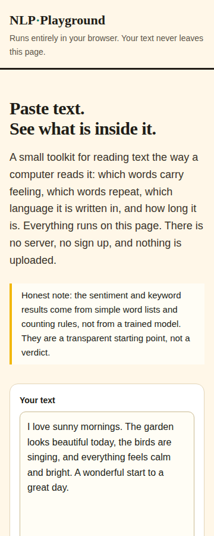
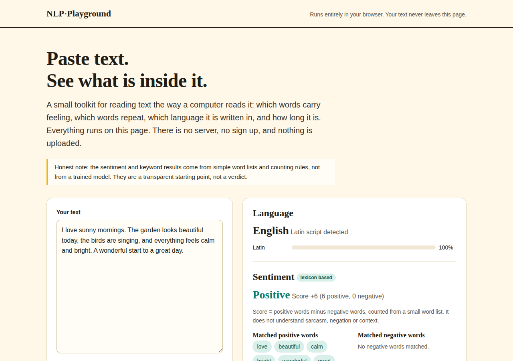

<div align="center">

# nlp-playground

**Paste text, see what is inside it — a free client side NLP toolkit.**

Sentiment, keywords, language detection and text stats, all computed in your browser. No server, no sign up, nothing uploaded.

[](https://github.com/smabdulmueid97/nlp-playground/blob/main/LICENSE)
[](https://github.com/smabdulmueid97/nlp-playground/stargazers)
[](https://github.com/smabdulmueid97/nlp-playground/commits/main)

**[▶ Try it in 10 seconds — live demo](https://smabdulmueid97.github.io/nlp-playground/)**

No signup. No backend.

</div>

---

## Screenshots

| Mobile | Desktop |
|---|---|
|  |  |

> Tested at 360 / 768 / 1280 px — no horizontal overflow, no clipped buttons.

## What it does

| Feature | How |
|---|---|
| Sentiment analysis | Lexicon based. Each word is checked against a small positive and negative word list, and every matched word is shown so the score is transparent. |
| Keyword extraction | Frequency based. Words are counted, common filler words are dropped, and the top 10 remain with their counts. |
| Language detection | Script and character patterns. Detects English, Arabic, Bengali, Hindi and Urdu, and shows the share of each script in mixed text. |
| Text stats | Words, sentences, characters, reading time and average sentence length. |
| One click samples | English, Arabic and Bengali sample texts so you can try it without typing anything. |

## Why this exists

Text classification is a core part of NLP work, but most demos hide their method behind an API call or a model you cannot inspect. This one does the opposite: every result shows its working. The sentiment score lists the exact words that produced it, the keywords show their counts, and the language result shows the script shares. It is a small, honest toolkit for anyone learning how rule based text analysis works, or for a quick check before reaching for a heavier tool.

## Quick start

No build step, no dependencies. Open the page, or run it locally:

```bash
git clone https://github.com/smabdulmueid97/nlp-playground.git
cd nlp-playground
python3 -m http.server 8000
# open http://localhost:8000
```

Or just open `index.html` in a browser. The demo is hosted on GitHub Pages.

## Usage

1. Paste or type text into the box on the left. Analysis updates as you type.
2. Or tap a sample: **English, happy day**, **Arabic, a good book**, or **Bengali, a rainy morning**.
3. Read the results on the right: language, sentiment with matched words, top keywords, and text stats.
4. Press **Clear** to start over.

## How it works

- **Sentiment:** score = positive words minus negative words, counted from a small word list in English, Arabic, Bengali, Hindi and Urdu. It does not understand sarcasm, negation or context.
- **Keywords:** words are counted after stopwords are removed. No ranking magic, just counting.
- **Language:** characters are grouped by script (Latin, Arabic script, Bengali script, Devanagari). Urdu is separated from Arabic by letters only Urdu uses, such as ے, ٹ, ڈ and ڑ.
- **Stats:** reading time assumes 200 words per minute. Average sentence length is words divided by sentences.

## Honest limitations

- The word lists are small, so short or unusual text can score neutral even when the feeling is clear to a human reader.
- Sentiment is rule based, not a trained model. It cannot read tone, irony or negation ("not happy" still matches "happy").
- Language detection works on script, so it cannot tell apart languages that share the Latin script.
- Everything runs client side, so very long pastes (tens of thousands of words) will feel slower than a short paragraph.

## Related repos

- [freelancer-skills](https://github.com/smabdulmueid97/freelancer-skills) — Claude Code skills for freelancer money work
- [social-media-posting](https://github.com/smabdulmueid97/social-media-posting) — schedule and draft social posts
- [long-to-short-video](https://github.com/smabdulmueid97/long-to-short-video) — cut long videos into shorts
- [invoice-generator](https://github.com/smabdulmueid97/invoice-generator) — single file invoice tool
- [ai-crypto-trader](https://github.com/smabdulmueid97/ai-crypto-trader) — crypto trading dashboard demo

## License

MIT — use it, sell with it, no attribution required.
